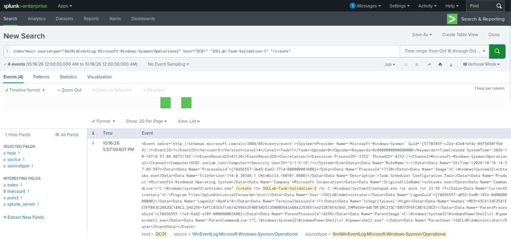
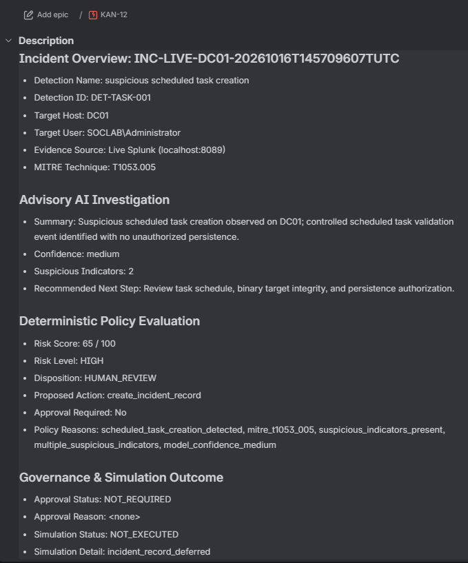

# DET-TASK-001 — Suspicious Scheduled Task Creation

## 1. Executive Summary

This case study documents the detection engineering, live telemetry validation, AI-assisted advisory investigation, and deterministic policy governance for **`DET-TASK-001`** (Suspicious Scheduled Task Creation).

Scheduled task creation on Windows endpoints via `schtasks.exe` is a high-frequency technique used by adversaries to establish persistence, elevate privileges, or execute recurring commands across system restarts (mapped to MITRE ATT&CK **`T1053.005`**). However, scheduled tasks are also created routinely by legitimate software updaters and system administrators. 

The objective of this implementation was to:
1. Author a robust, token-boundary-hardened detection rule across Microsoft Sysmon Event ID 1 process telemetry.
2. Validate the rule against real endpoint execution on a Windows Server 2022 Active Directory Domain Controller (`DC01`).
3. Subject the ingested telemetry to an AI-assisted advisory investigation that analyzes the context while remaining bound by strict deterministic security gates.
4. Demonstrate downstream ticket tracking in Jira Cloud while strictly preserving the boundary that Jira possesses zero response authority and endpoint containment remains simulated.

> **Operational Scope Notice**: This case study demonstrates controlled detection engineering and investigation in an isolated virtualized lab environment (`LabNet`). Creating a scheduled task in a controlled lab test does **not** prove adversary compromise or malicious persistence; the detection identifies suspicious task-creation behavior that warrants investigation.

---

## 2. Detection Engineering

### 2.1 Telemetry Source & Field Extraction
The detection ingests Windows Server 2022 endpoint telemetry forwarded from `DC01` to Splunk Enterprise via the Splunk Universal Forwarder:
* **Log Source**: Microsoft Sysmon Operational Event Log
* **Event ID**: `1` (Process Creation)
* **Sourcetype**: `XmlWinEventLog:Microsoft-Windows-Sysmon/Operational`
* **Target Executable**: `schtasks.exe`
* **Target Flag**: `/create`

### 2.2 Token-Boundary & Path Hardening
Naive detections for `schtasks.exe` and `/create` often suffer from false positives or bypasses due to substring matching (e.g., matching unrelated files named `myschtasks.exe` or arguments containing `/created_by`). The detection logic applies boundary-aware regular expressions:
* **Image Regex**: `(?i)(^|.*[\\/])schtasks[.]exe$` (ensures the executable name ends precisely at `schtasks.exe`, supporting both Windows backslashes and normalized slashes).
* **Command Line Regex**: `(?i)(^|[[:space:]])/create([[:space:]]|$)` (ensures `/create` is an isolated command-line switch surrounded by whitespace or string boundaries, preventing substring conflation).

### 2.3 Artifact References

| Artifact Type | File Location | Purpose |
| :--- | :--- | :--- |
| **Operational SPL Rule** | [`detections/splunk/suspicious_scheduled_task_creation.spl`](../../detections/splunk/suspicious_scheduled_task_creation.spl) | Authoritative Splunk search query with XML regex field extraction and boundary matching. |
| **Portable Sigma Rule** | [`detections/sigma/suspicious_scheduled_task_creation.yml`](../../detections/sigma/suspicious_scheduled_task_creation.yml) | Vendor-neutral detection definition tagged with `attack.persistence` and `attack.t1053.005`. |
| **Bounded Gateway Helper** | [`gateway/splunk_search.py`](../../gateway/splunk_search.py) | Typed Python client method `search_scheduled_task_creation` enforcing bounded parameters and static SPL templates. |

### 2.4 Authoritative Splunk Search Query
```spl
index=main sourcetype="XmlWinEventLog:Microsoft-Windows-Sysmon/Operational" "<EventID>1</EventID>"
| rex field=_raw "<Data Name=['\"]Image['\"]>(?<Image>[^<]+)</Data>"
| rex field=_raw "<Data Name=['\"]CommandLine['\"]>(?<CommandLine>[^<]+)</Data>"
| rex field=_raw "<Data Name=['\"]ParentImage['\"]>(?<ParentImage>[^<]+)</Data>"
| rex field=_raw "<Data Name=['\"]ParentCommandLine['\"]>(?<ParentCommandLine>[^<]+)</Data>"
| rex field=_raw "<Data Name=['\"]User['\"]>(?<User>[^<]+)</Data>"
| where match(Image, "(?i)(^|.*[\\\\/])schtasks[.]exe$")
| where match(CommandLine, "(?i)(^|[[:space:]])/create([[:space:]]|$)")
| table _time host User Image CommandLine ParentImage ParentCommandLine
```

---

## 3. Controlled Live Fixture

To validate telemetry ingestion, SIEM retrieval, and the investigator pipeline without introducing security risks into the lab, a controlled harmless scheduled task was generated on `DC01`.

### 3.1 Harmless Validation Command
Executed in an administrative console on Windows Server 2022 (`DC01`):
```cmd
schtasks.exe /create /tn "SOCLab-Task-Validation-3" /tr "C:\Windows\System32\notepad.exe" /sc once /st 23:59 /f
```

### 3.2 Fixture Safety & Isolation
* **Benign Target**: The scheduled task target was set strictly to `C:\Windows\System32\notepad.exe`.
* **Zero Payload Execution**: No malicious payloads, encoded scripts, network callbacks, or privilege escalation routines were executed.
* **Controlled Teardown**: Following successful telemetry capture and investigation validation, the task was manually deleted from `DC01`:
  ```cmd
  schtasks.exe /delete /tn "SOCLab-Task-Validation-3" /f
  ```

### 3.3 Validated Live Event Facts


*Historical live lab Sysmon Event ID 1 telemetry indexed in Splunk Enterprise for the controlled scheduled-task validation fixture (`SOCLab-Task-Validation-3`). The event captures `schtasks.exe /create` execution on DC01; detection evidence identifies suspicious task creation behavior and does not prove unauthorized adversary compromise.*

```json
{
  "timestamp": "2026-10-16 12:40:49.188 UTC",
  "host": "DC01",
  "user": "SOCLAB\\Administrator",
  "image": "C:\\Windows\\System32\\schtasks.exe",
  "command_line": "schtasks.exe /create /tn \"SOCLab-Task-Validation-3\" /tr \"C:\\Windows\\System32\\notepad.exe\" /sc once /st 23:59 /f",
  "parent_image": "C:\\Windows\\System32\\WindowsPowerShell\\v1.0\\powershell.exe",
  "detection_id": "DET-TASK-001",
  "mitre_technique_id": "T1053.005"
}
```

### 3.4 Historical Operational Disclosure: Ingestion Gap
During initial detection validation on 2026-10-15, an earlier validation event was dropped due to an operational storage ceiling on the Splunk indexer (free disk space fell below Splunk's default `minFreeSpace=2000MB` safety threshold). Truthful history is preserved: **that event was not recovered**. Following LVM disk expansion and receiver recovery on `Splunk-Server`, subsequent controlled live telemetry runs succeeded cleanly.

---

## 4. Detection & Investigation Pipeline

The runtime pipeline processes the alert through a strict unidirectional lifecycle:

```
[ DC01 Windows Server 2022 ]
  │  (Controlled execution: schtasks.exe /create ...)
  ▼
[ Sysmon Event ID 1 (Process Create) ]
  │  (Forwarded via port 9997)
  ▼
[ Splunk Enterprise (index=main) ]
  │
  ▼
[ Bounded Splunk Client (search_scheduled_task_creation) ]
  │  (Static SPL template; caller cannot supply arbitrary SPL)
  ▼
[ Exact Controlled Fixture Selector (_find_exact_scheduled_task_fixture) ]
  │  (Matches target task name; fails closed on negative/ambiguous matches)
  ▼
[ Deterministic MITRE Technique Mapping (map_mitre_technique) ]
  │  (Maps verified detection ID DET-TASK-001 -> T1053.005)
  ▼
[ AI Advisory Investigation (Live OpenAI gpt-5.6-sol or FakeModel) ]
  │  (Analyzes process attributes; produces hypotheses and confidence level)
  ▼
[ Authoritative Deterministic Policy Engine (RiskPolicyEngine) ]
  │  (Calculates additive score: 65/100 HIGH / HUMAN_REVIEW / create_incident_record)
  ▼
[ Append-Style JSONL Audit Logger (agent_audit.jsonl) ]
  │  (Strict allowlist serialization: sequence, event_type, incident_id, detail_code)
  ▼
[ Downstream Jira Cloud Dispatch (where enabled) ]
     (Creates ticket KAN-12; reporting only; zero response authority)
```

### Key Architectural Boundaries:
* **No Arbitrary SPL**: The investigator client cannot submit arbitrary SPL queries to Splunk; searches are restricted to pre-compiled templates with parameterized time windows (`minutes`) and result limits (`limit`).
* **Deterministic Authority**: The AI model has advisory authority only. It cannot alter the risk score, mutate detection rules, or authorize containment.
* **Downstream-Only Ticketing**: Jira Cloud is strictly an external case tracking sink with zero authority over policy evaluation or remediation.

---

## 5. Live Validation Runs

To maintain strict truthfulness, the repository documents two separate verified live validation runs for `DET-TASK-001`. **OpenAI advisory reasoning and Jira Cloud ticketing were validated in separate live pipelines, not in a single simultaneous run.**

### 5.1 Real Splunk + Deterministic FakeModel
Exercised during Milestone 18B-4 to validate the integrated control plane against real endpoint telemetry:

* **Incident ID**: `INC-LIVE-DC01-20261016T124049188TUTC`
* **Evidence Source**: `Live Splunk (localhost:8089)`
* **Bounded Events Retrieved**: Exactly 1 live Sysmon event
* **AI Advisory Model**: Deterministic `FakeModel`
* **Assessed Confidence**: `medium`
* **Suspicious Indicators**: 2 (`scheduled_task_creation`, `persistence_mechanism`)
* **Deterministic Risk Score**: `65 / 100` (`HIGH`, `HUMAN_REVIEW`)
* **Proposed Action**: `create_incident_record`
* **Approval Required**: `no` (ticketing/documentation is non-consequential)
* **Simulation Response**: `NOT_EXECUTED` (detail code: `incident_record_deferred`)
* **In-Memory Audit Events**: Exactly 8 chronological events (`MODEL_REQUESTED` → `TOOL_REQUESTED` → `TOOL_ALLOWED` → `TOOL_COMPLETED` → `MODEL_REQUESTED` → `FINAL_RESULT_ACCEPTED` → `POLICY_EVALUATED` → `SIMULATION_NOT_EXECUTED`)
* **Containment Execution**: None (`NOT IMPLEMENTED / NOT EXECUTED`)

### 5.2 Real Splunk + Live OpenAI Model
Exercised during Milestone 18B-5 to validate live cloud LLM decision loops against real telemetry:

* **Incident ID**: `INC-LIVE-DC01-20261016T143226781TUTC`
* **Evidence Source**: `Live Splunk (localhost:8089)`
* **OpenAI Model**: `gpt-5.6-sol` (OpenAI Python SDK `2.16.0`)
* **Assessed Confidence**: `medium`
* **Suspicious Indicators**: 4 (`schtasks_execution`, `create_flag`, `user_admin`, `powershell_parent`)
* **Model Reasoning**:
  * Correctly identified scheduled task creation (`schtasks.exe /create`).
  * Explicitly recognized the benign possibility: noted that the task name `SOCLab-Task-Validation-3` and target `notepad.exe` appeared characteristic of a controlled lab validation or administrative test.
  * Maintained truthfulness: Did not hallucinate active compromise or confirmed adversary persistence.
* **Deterministic Policy Gate**: Still produced authoritative score `65 / 100`, `HIGH`, `HUMAN_REVIEW`, `create_incident_record`.
* **In-Memory Audit Events**: Exactly 12 chronological events.
* **Ticketing Status**: No Jira ticket dispatch in this run.
* **Containment Execution**: None (`NOT IMPLEMENTED / NOT EXECUTED`).

### 5.3 Real Splunk + Real Jira Cloud Ticketing
Exercised during Milestone 18B-6 to validate live external case creation:

* **Incident ID**: `INC-LIVE-DC01-20261016T145709607TUTC`
* **Evidence Source**: `Live Splunk (localhost:8089)`
* **Investigation Model**: Deterministic `FakeModel`
* **Jira Cloud Ticket Created**: `KAN-12` (Issue Type: `Incident`, Project: `KAN`)
* **Created At UTC**: `2026-10-16T14:58:23.170286+00:00`
* **Ticket Formatting**: Hardened Atlassian Document Format (ADF) description containing incident metadata, detection ID `DET-TASK-001`, MITRE `T1053.005`, policy reason codes, and zero executable markup.
* **In-Memory Audit Events**: Exactly 10 chronological events (including `TICKET_REQUESTED` and `TICKET_CREATED`).
* **OpenAI Status**: No OpenAI API calls in this run (deterministic `FakeModel` used).
* **Containment Execution**: None (`NOT IMPLEMENTED / NOT EXECUTED`).


*Jira Cloud incident ticket KAN-12 created during the separate live Jira validation pipeline. Downstream ticketing functions strictly as an external tracking and reporting sink with zero response authority over risk scoring, policy evaluation, or containment. This run was performed separately from the live OpenAI scheduled-task validation pipeline.*

---

## 6. Deterministic Policy & Authority Boundary

The core security thesis of this architecture is that **the AI model never owns the security policy**. The model's outputs serve strictly as input signals into an authoritative, deterministic Python policy engine (`investigator/policy.py`).

### 6.1 Additive Scoring Formulation
For `DET-TASK-001`, the risk score is computed deterministically:

$$\text{Score} = \text{Base}(25) + \text{MITRE}(10) + \text{Indicators}_{\ge 1}(20) + \text{Indicators}_{> 1}(5) + \text{Confidence}_{\text{med}}(5) = 65$$

```python
# Extract from investigator/policy.py
if context.verified_detection_id == "DET-TASK-001":
    raw_score += 25
    reasons.append("scheduled_task_creation_detected")

if context.mitre_technique_id == "T1053.005":
    raw_score += 10
    reasons.append("mitre_t1053_005")

if context.suspicious_indicators_count >= 1:
    raw_score += 20
    reasons.append("suspicious_indicators_present")

if context.suspicious_indicators_count > 1:
    raw_score += 5
    reasons.append("multiple_suspicious_indicators")

if context.model_confidence == "medium":
    raw_score += 5
    reasons.append("model_confidence_medium")
```

### 6.2 Policy Invariants
* **Downgrade Rejection**: If the AI model reports `confidence: low` or recommends `LOW_OBSERVE`, the base detection and MITRE contributions (+35) ensure the incident cannot be silently dropped.
* **Bounded Indicator Weighting**: Model-supplied indicator counts are capped and bounded; hallucinating 100 indicators cannot artificially inflate the score beyond predefined bounds.
* **No Action Authority**: The model cannot select or execute containment actions; the `ActionPolicyEngine` maps a score of 65 to `HUMAN_REVIEW` and proposed action `create_incident_record`.
* **Zero Forced Approval for Documentation**: Non-consequential actions (`create_incident_record`) evaluate to `approval_required: no`, ensuring human approval is reserved exclusively for consequential containment actions.

---

## 7. Security Controls Demonstrated

| Security Control | Implementation Mechanism | Defensive Purpose |
| :--- | :--- | :--- |
| **Bounded Splunk Query** | Parameterized query method `search_scheduled_task_creation` in `gateway/splunk_search.py`. | Prevents arbitrary SPL execution and SQLi-style query injection into the SIEM. |
| **Exact Fixture Selector** | Helper `_find_exact_scheduled_task_fixture` matching task name `SOCLab-Task-Validation-3`. | Fails closed on ambiguous or unrelated task creation events. |
| **Tool Allowlisting** | Static compile-time registry in `investigator/tool_router.py`. | Ensures the investigator model can only call allowlisted tools (`map_mitre_technique`, etc.). |
| **Deterministic MITRE Mapping** | Authoritative static dictionary mapping in `investigator/tools/mitre_mapper.py`. | Prevents hallucinated or corrupted MITRE ATT&CK technique IDs from entering incident records. |
| **Deterministic Policy Gate** | Python scoring rules in `investigator/policy.py`. | Establishes model-independent risk scoring, action disposition, and policy reason tracking. |
| **Append-Style Audit Lifecycle** | Structured JSONL serialization in `investigator/audit_writer.py`. | Logs every step of the investigation with strict 4-field allowlisting (no raw telemetry or secrets). |
| **Downstream-Only Ticketing** | Jira Cloud REST API adapter in `investigator/providers/jira_provider.py`. | Downstream external tracking sink with zero authority over containment or scoring. |
| **No Arbitrary Shell Execution** | Absence of `subprocess`, `os.system`, or shell primitives in investigation tools. | Guarantees the AI agent cannot execute OS commands on the host or endpoints. |
| **Simulated Containment Boundary** | `investigator/simulated_response.py` recording `SIMULATED`. | Ensures zero unintended modification of enterprise hosts or network interfaces. |
| **Controlled Host Cleanup** | Manual `schtasks.exe /delete` execution following validation. | Restores endpoint to pristine state without automated agent intervention. |

---

## 8. Testing & Validation Evidence

The scheduled task detection and investigation implementation is backed by a complete pyramid of offline tests and live environment validations.

### 8.1 Evidence Classification Matrix

| Component / Test Suite | Primary File | Scope & Result | Operational Status |
| :--- | :--- | :--- | :--- |
| **Scheduled Task Detection Tests** | `tests/test_detection_scheduled_task.py` | 18 unit tests verifying SPL generation, parameter bounds, XML parsing, and regex matching. | **TESTED OFFLINE** |
| **Scheduled Task Investigation Tests** | `tests/test_investigation_scheduled_task.py` | 15 unit tests verifying `InvestigationInput`, fake model schemas, and policy scoring. | **TESTED OFFLINE** |
| **End-to-End Integration Tests** | `tests/test_end_to_end_demo.py` | 35 integration tests exercising CLI flags, provider selection, and audit generation. | **TESTED OFFLINE** |
| **Repository Test Suite** | Full test discovery (`test_*.py`) | **1,897 / 1,897 tests PASS** across the entire repository at M18 closure. | **TESTED OFFLINE** |
| **Live Endpoint Telemetry Ingestion** | DC01 Sysmon Event ID 1 forwarder | Captured real Windows process creation event in Splunk `index=main`. | **LIVE LAB VALIDATED** |
| **Live Bounded Splunk Search** | `gateway/splunk_search.py` | Retrieved exactly 1 live event matching `SOCLab-Task-Validation-3`. | **LIVE LAB VALIDATED** |
| **Live FakeModel Integrated Flow** | `scripts/run_end_to_end_demo.py` | Incident `INC-LIVE-DC01-20261016T124049188TUTC` (Score: 65, HIGH, HUMAN_REVIEW). | **LIVE LAB VALIDATED** |
| **Live OpenAI Advisory Path** | `scripts/run_end_to_end_demo.py` | Incident `INC-LIVE-DC01-20261016T143226781TUTC` with live `gpt-5.6-sol` advisory loop. | **LIVE LAB VALIDATED** |
| **Live Jira Cloud Incident Ticketing** | `scripts/run_end_to_end_demo.py` | Incident `INC-LIVE-DC01-20261016T145709607TUTC` creating live Jira ticket `KAN-12`. | **LIVE LAB VALIDATED** |
| **Consequential Action Containment** | `investigator/simulated_response.py` | Containment action explicitly `SIMULATED`; zero real host mutation. | **NOT IMPLEMENTED / NOT EXECUTED** |

---

## 9. Operational Finding: Splunk Storage & Telemetry Reliability

During Milestone 18, a real operational failure occurred on the `Splunk-Server` indexer that provided a critical engineering lesson:

* **The Incident**: On 2026-10-15, an initial controlled validation task was executed on `DC01`, but failed to appear in Splunk searches. Investigation revealed that the Splunk Universal Forwarder was blocked from indexing because the Splunk indexer had paused incoming indexing streams.
* **Root Cause**: The root filesystem (`/dev/ubuntu-vg/ubuntu-lv`) was originally sized at ~19 GB. Accumulated OS packages, Python virtual environments, and log files caused free space to fall below 2,000 MB, triggering Splunk's internal disk protection threshold (`minFreeSpace=2000MB`).
* **Resolution**: Because the VirtualBox virtual disk was 40 GB and the LVM volume group (`ubuntu-vg`) contained ~19 GB of unallocated extents, the root logical volume was extended using `lvextend -r -l +100%FREE /dev/ubuntu-vg/ubuntu-lv`. This expanded the filesystem to ~38 GB, providing ~21 GB of free disk space.
* **Outcome**: Splunk resumed indexing on port `9997` immediately upon restart.
* **Engineering Lesson**: **Telemetry pipeline reliability is an inseparable prerequisite of detection engineering.** A detection rule is only as effective as the underlying ingestion pipeline. Engineering defensible SOC automation requires monitoring forwarder queue states, indexer storage ceilings, and fail-closed parser states.

---

## 10. Interview Takeaways

When discussing this case study with technical interviewers and hiring managers, this implementation demonstrates:

1. **Practical Detection Engineering**: Authored and hardened production-style Sigma and Splunk SPL detection rules for persistence mechanisms (`T1053.005`) using token-boundary regexes rather than fragile substrings.
2. **Live Multi-Tier Telemetry Validation**: Validated the complete telemetry lifecycle from a real Windows Server Active Directory domain controller through Sysmon Event ID 1 forwarders to a Linux-based Splunk Enterprise indexer.
3. **Context & Authorization Awareness**: Demonstrated that the AI advisory layer recognized the controlled lab characteristics (`notepad.exe`, validation naming) and noted the possibility of benign administrative activity rather than immediately asserting compromise.
4. **LLM Advisory Guardrails**: Constrained the LLM strictly to an advisory role with bounded tool routing, schema validation, and runtime execution budgets. The model cannot execute arbitrary shell commands or alter SIEM queries.
5. **Deterministic Policy Authority**: Enforced an architecture where deterministic Python policy engines calculate authoritative risk scores additively from evidence, ensuring the LLM cannot downgrade or suppress critical security alerts.
6. **Immutable Auditability**: Captured a complete chronological audit trail of all tool requests, policy decisions, and external dispatches with strict field allowlisting.
7. **Defensible Truthfulness & Simulation Boundaries**: Maintained rigorous engineering honesty by documenting that endpoint containment is strictly simulated, distinguishing separate live validation runs, and noting that controlled testing does not prove malicious compromise.

---

## 11. Limitations & Explicit Non-Claims

To ensure complete technical integrity across interviews and documentation:
* **Controlled Task Creation Does Not Prove Compromise**: Executing `schtasks.exe /create` in a controlled lab test generates telemetry for detection rule verification. It does not prove adversary intrusion or unauthorized persistence.
* **No Malicious Payload Executed**: The target executable was strictly `notepad.exe`. No malware, command-and-control beacons, or unauthorized scripts were executed on `DC01`.
* **No Credential Dumping or Lateral Movement**: This case study covers persistence detection telemetry only. It does not include LSASS dumping or Active Directory exploitation.
* **No Real Containment Implemented**: The system has zero capability to terminate endpoint processes, disable Active Directory user accounts, or isolate network adapters. All response actions remain strictly simulated (`SIMULATED`).
* **No Autonomous Remediation**: The AI investigator does not autonomously resolve alerts or apply remediation actions. Consequential decisions require explicit human authorization.
* **Separate Live Validation Pipelines**: OpenAI advisory investigation (`gpt-5.6-sol`) and Jira Cloud incident creation (`KAN-12`) were validated in distinct, separate live pipeline executions. They were not executed simultaneously in a single live run.
* **No Production SOC Scale Claim**: This implementation was tested against single-incident workflows and controlled fixtures; it is not benchmarked for high-throughput enterprise SIEM ingestion.
